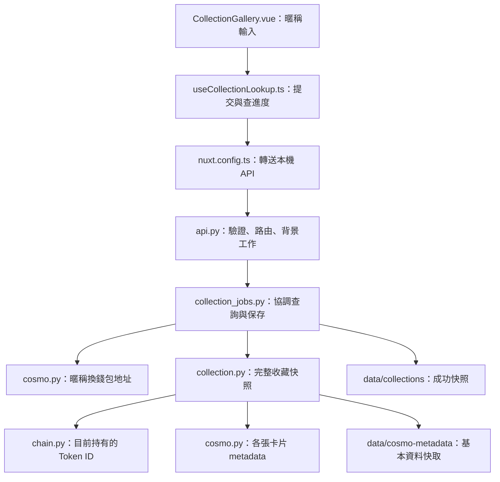

# 專案導讀：從暱稱到完整 Objekt 圖鑑

更新日期為 2026-11-23（Asia/Taipei）。先跑一個小範例，再依資料流閱讀。檔案地圖涵蓋目前 33 個自行維護的檔案。

首頁是空白暱稱輸入頁。送出後先顯示找到的帳號，鏈上清單通過核對就能翻頁。程式先補目前頁面，再繼續讀其餘卡片。重新整理會回到輸入頁。每頁顯示 60 張，大型收藏的頁數會隨總張數增加。

## 1. 先跑最小範例

在專案根目錄執行，不需要先啟動網頁或 FastAPI：

```powershell
.\.venv\Scripts\python.exe -X utf8 -c "from cosmo import fetch_public_account; print(fetch_public_account(input('COSMO 暱稱：').strip()))"
```

執行後輸入自己的 COSMO 暱稱。成功時會得到以下欄位，這裡的值是示意：

```python
{
    'nickname': '<你輸入的暱稱>',
    'address': '<官方回傳的錢包地址>'
}
```

這一行先用 `input()` 等待你輸入暱稱，再做三件事：`from ... import ...` 取得函式；`fetch_public_account(...)` 把暱稱交給官方介面；`print(...)` 顯示回傳的字典。輸入是暱稱，輸出是暱稱與錢包地址，這時還沒有卡片清單。`-X utf8` 避免 Windows 終端機的中文字元編碼問題。

先觀察這兩個欄位，再照 [README](../README.md#先執行) 啟動 API 與網頁，按一次「讀取收藏」。接著從第 3 節開始逐段讀。

## 2. 整體資料流程與檔案地圖



Python 依序回報帳號、已核對的持有清單與接著取得的卡片資料。Vue 依 Token ID 把資料放回卡片的位置，再把當頁的卡片交給 `OwnedObjektCard.vue`。全部通過完整性驗證才保存完整快照。

### Python 與測試檔案

| 檔案 | 功能與先看的位置 |
| --- | --- |
| [api.py](../api.py) | 本機 HTTP 入口。先讀 `NicknameRequest` 與 `create_app()` 裡的 `start()`；第 5 節解釋 |
| [collection_jobs.py](../collection_jobs.py) | 管理工作編號、進度、成功／失敗，保存完整快照。先讀 `CollectionJobs.run()`；第 6 節解釋 |
| [cosmo.py](../cosmo.py) | 直接查官方帳號與卡片基本資料，轉成我們的欄位。先讀 `fetch_public_account()`；第 7 節解釋 |
| [chain.py](../chain.py) | 用 Abstract RPC 與 Multicall3，在同一區塊列出持有 Token ID。先讀 `fetch_owned_tokens()` |
| [collection.py](../collection.py) | 組合持有清單、metadata、快取與完整性驗證。先讀 `fetch_collection()`；第 9 節解釋 |
| [upstream.py](../upstream.py) | `retry_read()` 在唯讀請求出現限流或暫時性連線錯誤時等待再試 |
| [sync_collection.py](../sync_collection.py) | 可選的命令列入口，在終端機輸入暱稱，匯出完整 JSON。先讀 `main()`；第 10 節解釋 |
| [tests/test_api.py](../tests/test_api.py) | 驗證暱稱、工作進度、同時查詢限制、成功保存、失敗保留及並行原子寫入 |
| [tests/test_cosmo.py](../tests/test_cosmo.py) | 驗證官方欄位轉換、Unit 多成員、帳號與 Token ID 格式，避免猜測發行序號 |
| [tests/test_chain.py](../tests/test_chain.py) | 驗證批次回應還原、同區塊枚舉、零持有、區塊變動，以及超過 10,000 筆仍完整取得 |
| [tests/test_collection.py](../tests/test_collection.py) | 驗證同款不同張、metadata 快取、拒絕部分快照及 CLI 失敗保留 |

### 網頁檔案

| 檔案 | 功能與關鍵位置 |
| --- | --- |
| [web/app/app.vue](../web/app/app.vue) | 整個網頁的根元件，只掛載 `<CollectionGallery />` |
| [CollectionGallery.vue](../web/app/components/CollectionGallery.vue) | 暱稱輸入、帳號與已核對的持有清單、卡片補讀、篩選與分頁 |
| [useCollectionLookup.ts](../web/app/composables/useCollectionLookup.ts) | 提交暱稱、定期讀取進度和新卡片資料，組合完整結果 |
| [OwnedObjektCard.vue](../web/app/components/OwnedObjektCard.vue) | 顯示一張持有卡的圖片、成員、季節、代碼、Token ID；第 11 節解釋 |
| [types/objekt.ts](../web/app/types/objekt.ts) | `Objekt` 與 `CollectionSnapshot` 型別，描述卡片與完整快照的欄位 |
| [types/collection-job.ts](../web/app/types/collection-job.ts) | 定義工作狀態、`CollectionJobUpdate` 分批回應與 `CollectionPreview` 畫面資料 |
| [utils/collection.ts](../web/app/utils/collection.ts) | `parseCollectionSnapshot()` 真正檢查收到的資料，避免把錯誤回應當成收藏 |
| [assets/css/main.css](../web/app/assets/css/main.css) | 網頁配色、表單、卡片與響應式排版；第 11 節解釋 |
| [web/tests/collection-gallery.test.mjs](../web/tests/collection-gallery.test.mjs) | 使用真正的元件程式測試空白首頁、10,001 筆分頁與查詢失敗保留；第 12 節解釋 |
| [web/nuxt.config.ts](../web/nuxt.config.ts) | 客戶端渲染、API 轉送、樣式載入及網頁標題 |
| [web/tsconfig.json](../web/tsconfig.json) | 引用 Nuxt 產生的 TypeScript 設定，讓編輯器與型別檢查理解 Nuxt 專案 |
| [web/package.json](../web/package.json) | 網頁套件與 `dev`、`typecheck`、`build` 等執行命令 |
| [web/package-lock.json](../web/package-lock.json) | 鎖定實際依賴版本供 `npm ci` 重現安裝，由 npm 維護 |
| [web/README.md](../web/README.md) | 網頁操作與閱讀順序的短索引 |

### 專案設定與文件

| 檔案 | 功能與關鍵內容 |
| --- | --- |
| [requirements.txt](../requirements.txt) | 固定 FastAPI 與 Uvicorn 的直接依賴版本；前者處理 API，後者執行 HTTP 服務 |
| [requirements-dev.txt](../requirements-dev.txt) | `-r requirements.txt` 納入執行依賴，再加入 TestClient 使用的 httpx |
| [.gitignore](../.gitignore) | 排除本機資料、環境變數、Python／Node 依賴與產生檔；不會刪除檔案 |
| [README.md](../README.md) | 專案入口：啟動、驗證、目前功能與限制 |
| [docs/TEACHING.md](TEACHING.md) | 本文件：每個自訂檔案與關鍵程式碼的導讀 |
| [docs/cosmo-api.md](cosmo-api.md) | API 與合約的查找來源、Proxy 原理，以及已驗證和未驗證的範圍 |
| [AGENTS.md](../AGENTS.md) | Codex 協作規則、教學偏好與目前專案邊界 |
| [HANDOFF.md](../HANDOFF.md) | 接續工作所需的最新狀態、測試證據與待辦 |

### 執行後產生的本機資料

| 路徑 | 用途 |
| --- | --- |
| `data/collections/2741/<contract>/latest.json` | API 保存的最近成功收藏；目前首頁不會自動讀它 |
| 同目錄 `<wallet>.json` | 按錢包保存成功快照；目前未提供選擇歷史快照的介面 |
| `data/cosmo-metadata/2741/<contract>/<token>.json` | 每張卡的原始 metadata、Token ID 與快取時間 |
| `web/public/data/collection.json` | CLI 匯出的完整 JSON，供本機檢查；目前網頁不自動讀取 |
| `data/research/` | 最近一次圖鑑的本機驗證截圖，不參與執行 |
| `data/backups/` | 本次清理前的 ZIP 備份，不參與執行 |
| `.venv/`、`web/node_modules/` | 已安裝的 Python 與 Node 套件，保留供目前程式執行 |
| `__pycache__/`、`tests/__pycache__/` | Python 執行後產生的位元碼快取，可重建 |
| `web/.nuxt/`、`web/node_modules/.cache/` | Nuxt 的產生型別、開發／建置快取，可重建 |
| `web/.output/` | 正式建置輸出，可用 `npm run build` 重建 |

`data/` 與匯出 JSON 已由 Git 忽略。查詢成功後會建立所需資料夾。首頁從空白開始，送出暱稱後才取得該次查詢的資料。

## 3. CollectionGallery.vue：輸入與畫面

```vue
<input id="cosmo-nickname" v-model="nickname" ...>
<form ... @submit.prevent="lookupCollection">
```

以上是語法摘錄，省略號表示其他屬性。`v-model` 把輸入框與 `nickname` 連在一起；`@submit` 監聽表單提交；`.prevent` 阻止瀏覽器照一般表單方式換頁。按鈕和輸入框都放在實際程式的 `<form>` 裡。

```ts
const data = shallowRef<CollectionSnapshot | null>(null)
const nickname = ref('')
const target = nickname.value.trim().replace(/^@/, '')
const result = await loadCollection(target)
if (!result) return
data.value = result
lookupPreview.value = null
```

`ref()` 是 Vue 會追蹤變化的值，在 `<script>` 裡用 `.value` 讀寫，在模板通常會自動解開。`nickname` 從空字串開始，`data` 從 `null` 開始，因此開頁時沒有帳號資料。

`shallowRef()` 只追蹤整份資料的替換，不為每張卡片建立深層的響應式追蹤，適合目前只讀、一次換入完整快照的流程。`CollectionSnapshot | null` 是 TypeScript 聯集型別，代表「完整快照，或尚未查詢」。Nuxt 會自動匯入這些 Vue API，因此此檔不需要逐一寫 `import { ref, computed, ... } from 'vue'`。

`allCards` 從目前快照或 `preview.tokenIds` 產生卡片列表。用 Token ID 從 `preview.cards` 找到資料就顯示卡片，還沒取得時用 `{ external_token_id: token }` 保留位置。`?.` 在資料缺少時停止取值，`??` 為缺少的值提供預設值。

`trim()` 去掉頭尾空白，`replace(/^@/, '')` 去掉開頭的一個 `@`。`loadCollection()` 在等待期間持續更新 `lookupPreview`。只有取得完整結果才替換 `data` 並清除預覽。個別卡片資料缺少時，畫面仍可用預覽顯示已核對的持有清單。

帳號一確認就會更新標題下方的暱稱。模板使用 `v-if="total !== undefined"` 等待已核對的持有清單，之後才顯示張數、篩選器和頁碼。重新整理會重新執行元件，回到空白輸入狀態。

`useCollectionLookup()` 回傳多個值；`const { load: loadCollection } = ...` 是解構並改名，所以此元件呼叫的 `loadCollection()` 就是下一節的 `load()`。

```ts
const pageCards = computed(() => filteredCards.value.slice(
  (currentPage.value - 1) * PAGE_SIZE,
  currentPage.value * PAGE_SIZE,
))
```

`computed()` 依其他值自動重新計算。`filteredCards` 用 `filter()` 篩選整份收藏；`slice(start, end)` 再取出本頁，包含起點、不含終點。第 1 頁就是索引 0 到 59。搜尋或篩選改變時，`watch()` 將頁碼重設為 1。

```vue
<template v-for="card in pageCards" :key="card.external_token_id">
  <OwnedObjektCard v-if="'member' in card" :objekt="card" />
</template>
```

`v-for` 每次處理一筆持有紀錄，`:key` 使用個別 Token ID。`'member' in card` 用來辨別完整資料，通過後才用 `:objekt` 交給子元件。程式另有 `v-else` 顯示等待資料的卡片位置。成員與季節篩選會隨 metadata 更新。若知道 Token ID，可以直接搜尋該張持有紀錄。

熟悉後只改 `PAGE_SIZE = 60` 為 `24`，觀察頁數增加，但持有總數不變。這個值不控制鏈上查詢筆數。

## 4. useCollectionLookup.ts：提交與定期讀進度

```ts
const initial = parseJob(await $fetch('/api/collections/sync', {
  method: 'POST', body: { nickname }, retry: 0, signal: requestSignal(signal),
}))
```

`$fetch` 發出 HTTP 請求，`body: { nickname }` 傳送 JSON。POST 回應先給工作編號與狀態，收藏查詢在背景執行。`retry: 0` 避免提交動作自動重送；每次 HTTP 請求最多等待 10 秒。

```ts
const job = parseJob(await $fetch(jobUrl, {
  query: { cursor, include_tokens: tokenIds === null },
  retry: 2, retryDelay: 750, signal: requestSignal(signal),
}))
```

GET 平時每秒查一次。`cursor` 是已收到的卡片資料筆數，下次從 `next_cursor` 接續。如果 `has_more` 為 `true`，代表伺服器已有更多可讀資料，瀏覽器會立刻接著取。Token ID 清單只在前端還沒收到時索取。`requestSignal()` 合併離開頁面的取消訊號和單次請求的 10 秒逾時。

`CollectionGallery.vue` 用 `watch()` 比對目前頁面的 Token ID。頁面換成另一批卡片時，`prioritize()` 把該頁還缺資料的 ID 送給 API。快速連續翻頁時，已在傳送的請求結束後只送最後一頁的優先順序。

`parseJob()` 檢查工作格式，`parseUpdate()` 檢查回應中的持有張數與卡片。`Map` 用 Token ID 保存每張已到達的卡片。全部到齊後依核對過的 Token ID 順序組合，再交給 `parseCollectionSnapshot()` 驗證。`finally` 恢復按鈕。元件卸載時，`AbortController` 會結束瀏覽器的等待，已開始的 Python 工作可繼續完成。

## 5. api.py：FastAPI 入口

```python
class NicknameRequest(BaseModel):
    model_config = ConfigDict(extra="forbid")
    nickname: str = Field(min_length=1, max_length=64)
```

這是 Pydantic 資料模型，檢查請求必須有字串暱稱，長度 1–64，不接受額外欄位。`field_validator(..., mode="before")` 先去掉前後空白與開頭的 `@`，並拒絕控制字元；不合格回覆 HTTP 422。

```python
@app.post("/collections/sync", status_code=202)
def start(request: NicknameRequest, background_tasks: BackgroundTasks, response: Response):
    # 實際程式另有 Cache-Control 與忙碌時的錯誤處理。
    job, created = service.create(request.nickname)
    if created:
        background_tasks.add_task(service.run, job["job_id"])
    return job
```

`@app.post(...)` 將網址與函式連接。HTTP 202 表示已接受查詢；FastAPI 回應後，才執行加入的背景函式。它不會在回傳工作編號前等全部卡片查完。

| Python 路徑 | 用途 |
| --- | --- |
| `GET /health` | 確認 API 運行 |
| `POST /collections/sync` | 建立或沿用查詢工作 |
| `GET /collections/jobs/<job_id>?cursor=0&include_tokens=true` | 讀取進度、帳號、持有清單與該游標之後最多 300 張卡片資料 |
| `POST /collections/jobs/<job_id>/prioritize` | 通知 API 先讀目前頁面最多 60 張卡。工作只採用已核對的持有 Token ID |
| `GET /collections/jobs/<job_id>` | 保留原先可回傳整份成功快照的介面 |
| `GET /collections/latest` | 保留的本機快照讀取介面，首頁不自動呼叫；尚無快照時回覆 404 |

瀏覽器使用的路徑多了 `/api` 前綴，由 Nuxt 轉送。`create_app(jobs=...)` 允許測試傳入自己的工作管理器與暫存目錄，避免影響真實資料。

## 6. collection_jobs.py：把查詢串起來

`CollectionJobs` 是管理工作的類別，`self._jobs` 放各工作狀態，`self._active_id` 指向正在執行的工作。`Lock()` 確保不同 HTTP 請求不會同時修改這些共享資料。

`create()` 產生 `uuid4().hex` 工作編號。相同暱稱的進行中工作會沿用，其他暱稱回覆忙碌錯誤；最多保留 20 個工作的記憶體資料。API 重啟後舊工作編號失效。

```python
account = fetch_public_account(job["nickname"])
self._update(job_id, account=account, progress="已找到帳號，正在查詢鏈上持有清單…")
```

`run()` 先公布已確認的帳號，再呼叫 `fetch_collection()`。背景工作透過 `on_tokens` 更新持有清單，透過 `on_card` 加入取得的卡片資料。`lambda` 是簡短函式，讓底層回傳進度或新資料時可立即更新工作。`get()` 依 `cursor` 切出固定大小的資料，讓 FastAPI 不必在每次輪詢傳整份快照。

```python
write_json_atomic(self.directory / f"{account['address'].lower()}.json", snapshot)
write_json_atomic(self.directory / "latest.json", snapshot)
```

實際程式先驗證 `complete`、帳號、張數與不重複 Token ID，再保存錢包檔與最近成功檔，最後才標示成功。`Path / "檔名"` 是組合路徑，這裡的 `/` 不表示數學除法。

`except` 將不存在的暱稱、來源錯誤、儲存錯誤等轉成可顯示訊息；失敗不取代最近成功快照。`finally` 釋放目前工作的名額，讓下一次查詢能執行。現在是本機單一程序，沒有跨程序的工作佇列，因此 Uvicorn 不加 `--workers`。

## 7. cosmo.py：官方資料與欄位轉換

```python
path = f"/bff/v3/users/by-nickname/{quote(username, safe='')}"
data = retry_read(lambda: _get_json(path))
return {"nickname": nickname, "address": address}
```

`_get_json()` 用 `urllib.request` 送出 HTTPS GET，`json.load()` 將 JSON 轉成 Python 字典。f-string 把暱稱放進路徑；`quote()` 將路徑中的特殊字元編碼。回傳前檢查暱稱是否一致、錢包是否為合法的 40 位十六進位地址。

`upstream.py` 裡的 `retry_read()` 最多嘗試三次。收到 `429` 或暫時性連線錯誤會短暫等待，已知暱稱不存在時直接回報。`open_metadata_connection()` 提供可重用的 HTTPS 連線，卡片查詢逐張進行時就能省去重複建立連線的時間。

`fetch_objekt_metadata(token_id)` 用另一條路徑查指定卡片，`normalize_objekt_metadata()` 將 `attributes` 清單轉成我們使用的欄位。來源中的 `Member` 可能有多筆，所以會保留：

```python
"member": "S4 X S18",                  # 畫面上的組合名稱
"members": ["ChaeYeon", "JooBin"],    # 可搜尋、可篩選的個別成員
```

以上是某張 Unit 卡的欄位摘錄。一般卡片的 `members` 也會是一個陣列，因此前端可以使用同一套處理方式。函式建立新字典，不改動原始 metadata。它不會從名稱推算發行序號，也不會從圖片資料判定持有人。

## 8. chain.py：列出目前全部持有

`fetch_owned_tokens(address)` 先取得 Abstract 的 Chain ID 與最新區塊，再將本次所有持有查詢固定在這個區塊。這能避免查詢途中轉移卡片，導致混合不同時點的清單。

```python
owner_parameter = address[2:].lower().zfill(64)
balance_result = _read_rpc([
    _contract_call("0x70a08231" + owner_parameter, block_tag)
])[0]
total = decode_uint256(balance_result)
```

`address[2:]` 去掉 `0x`，`zfill(64)` 補零成合約參數需要的長度。`0x70a08231` 是 `balanceOf` 的函式識別碼；這個呼叫讀取持有張數。`decode_uint256()` 檢查完整的回傳格式，再以 `int(value, 16)` 將十六進位轉成整數。

接著用 `tokenOfOwnerByIndex(address, index)` 逐一列出持有 Token ID，識別碼為 `0x2f745c59`。`f"{index:064x}"` 將索引格式化為補零的 64 位十六進位字串。`_aggregate_uint256()` 把最多 200 次讀取編成一個 Multicall3 請求，並檢查每筆結果。`fetch_owned_tokens()` 同時查詢最多兩批，每批使用同一區塊。節點拒絕聚合呼叫時，改用每批最多 50 筆的直接查詢。

`rpc_batch()` 是 JSON-RPC 的 HTTP POST，這裡呼叫 `eth_call` 等唯讀方法，不會送出鏈上交易。批次回應順序可能改變，因此用每筆的 `id` 還原；缺筆、重複、錯誤或不符的 id 都會拒絕。最後確認張數與 Token ID 唯一性。

`verify_snapshot_block()` 先在持有清單送出前檢查，再在卡片資料查詢完成時重查。區塊雜湊改變代表原資料時點失效，畫面會撤回該清單，最近成功的完整快照可留供後續使用。

## 9. collection.py：整合、快取與完整快照

```python
ownership = fetch_owned_tokens(account["address"], progress)
token_ids = sorted(ownership["token_ids"], key=int, reverse=True)
if on_tokens:
    verify_snapshot_block(ownership["block_number"], ownership["block_hash"])
    on_tokens(token_ids)
```

`fetch_collection()` 每次都從鏈上取得持有清單。`_fetch_card()` 再為每個 Token ID 讀取卡名、圖片網址等 metadata。有未滿 7 天的有效快取就直接使用，缺少或到期才向官方查詢。

```python
priority = get_priority() if get_priority else ()
token_id = next((token for token in priority if token in unscheduled), None)
if token_id is None:
    token_id = next(token for token in remaining if token in unscheduled)
unscheduled.remove(token_id)
```

`unscheduled` 是還沒派工的 Token ID 集合。`next(..., None)` 先找目前頁面第一張還沒派工的卡。沒有符合的卡，就照原本的 Token ID 順序繼續讀取。派工後從集合移除，同一張卡就只處理一次。

`ThreadPoolExecutor` 最多同時查 8 張卡。`Future` 代表稍後才有結果的工作。`wait(..., FIRST_COMPLETED)` 等到任一張完成，就送出結果並補下一張。切換到靠後的頁面時，新頁面會使用下一個空位。連線用 `Queue` 借出並歸還，收到 HTTP 429 時，這批 worker 共用暫停時間。

依 Token ID 排好的持有清單提供穩定頁碼，卡片資料可按查詢完成順序送出。少數 metadata 失敗時，畫面還能用該 ID 辨識卡片，完整快照會留待資料補齊才寫入。`set()` 將相同的「藝人、季節、成員／組合名稱、完整卡款代碼」合併計算不同卡款，每張持有紀錄仍分開保留。

`ownership_at` 是持有查詢區塊的時間，`fetched_at` 是這次整合完成時間。metadata 可能來自快取，因此同步完成時間不表示所有圖片資料都在那一秒重新下載。

### write_json_atomic() 為什麼不直接覆寫？

```python
with NamedTemporaryFile(..., dir=path.parent, delete=False) as stream:
    json.dump(data, stream, ensure_ascii=False, indent=2)
temporary.replace(path)
```

這是核心流程摘錄。先在同目錄完整寫好不同名稱的暫存檔，再原子替換目標，避免讀到半份 JSON。Windows 遇到短暫的目標鎖定時有限重試；`finally` 清掉暫存檔。這是單檔替換，不是資料庫交易。

## 10. sync_collection.py：保留的命令列工具

```python
username = input("COSMO 暱稱：").strip().removeprefix("@")
account = fetch_public_account(username)
snapshot = fetch_collection(account, progress=lambda message: print(message, flush=True))
write_json_atomic(OUTPUT_PATH, snapshot)
```

以上是主流程摘錄。可以不啟動 FastAPI，直接執行 `python -X utf8 sync_collection.py`，在終端機輸入自己的暱稱，觀察進度或產生網頁完整 JSON 備援。`input()` 取得執行時的輸入，程式不儲存固定個人帳號；實際程式也會拒絕空白輸入。

它與 API 共用 `cosmo.py`、`chain.py`、`collection.py`，不重寫抓取邏輯。只有成功才寫入 `web/public/data/collection.json`，API 保存的 `data/collections/.../latest.json` 不受影響。這份 JSON 是可選的本機匯出檔，網頁不會在開啟或查詢失敗時自動讀取它。

`if __name__ == "__main__":` 只在直接執行檔案時啟動，讓測試可以匯入而不真的連線。`SystemExit(main())` 將成功的 0、失敗的 1 交給終端機。

## 11. 卡片、型別、資料檢查與樣式

`app.vue` 只掛載圖鑑。`OwnedObjektCard.vue` 用 `defineProps<{ objekt: Objekt }>()` 接收父元件交進來的一張卡；`{{ objekt.member }}` 顯示文字，`:src="objekt.image_url"` 綁定圖片網址。`loading="lazy"` 延後載入較遠的圖片；`@error` 設定 `imageFailed`，由 `v-if` 改顯示替代文字，卡片其他資訊仍在。

`types/objekt.ts` 定義單張 `Objekt` 及整份 `CollectionSnapshot`。Token ID 用字串保存，`members` 固定為陣列；`complete: true` 表示此型別只代表完整快照。`types/collection-job.ts` 的狀態使用字串聯集，限制為四個名稱；`snapshot: unknown` 代表尚未驗證的結果。

```ts
status: 'queued' | 'running' | 'succeeded' | 'failed'
```

這是工作型別的欄位摘錄。`|` 表示只能使用列出的其中一個狀態。單張卡的欄位分成識別（`external_token_id`）、展示（`name`、`image_url`）、分類（`artist`、`member`、`members`、`season`、`collection_code`、`class_name`）；快照再加上帳號、張數、卡片陣列、來源、鏈／合約、區塊與時間。這樣一張卡與整份查詢結果各有清楚的用途。

TypeScript 型別只協助開發，不會自動驗證伺服器回應。`utils/collection.ts` 先將收到的值視為 `unknown`，逐項檢查欄位、帳號、鏈與合約、時間、完整性、卡款統計及 Token ID 唯一性，通過後才當成 `CollectionSnapshot` 使用。

`main.css` 的 `:root` 放全站顏色與字體，`.collection-grid` 用 CSS Grid 排卡片；`repeat(6, minmax(0, 1fr))` 代表六個可收縮的等寬欄位。`@media` 依寬度改成五／四／三／兩欄；手機也把暱稱輸入和按鈕改為直排。`prefers-reduced-motion` 尊重使用者的減少動態效果設定。

## 12. 設定檔與測試的關鍵

`nuxt.config.ts` 使用 `ssr: false`，由瀏覽器執行圖鑑。`css` 掛載樣式，`app.head` 設定中文、標題與描述。轉送設定是：

```ts
routeRules: {
  '/api/collections/**': { proxy: 'http://127.0.0.1:8000/collections/**' },
}
```

這讓前端向自己的網頁伺服器請求，再由它轉給 Python。例如 `/api/collections/latest` 對應 Python 的 `/collections/latest`。這個轉送用途和手機流量觀察不同。

`package.json` 的 `scripts` 決定 `npm run dev` 等命令做什麼；`dependencies` 是執行套件，`devDependencies` 是開發工具。`overrides` 保留先前對間接依賴 minimatch 的修正。`package-lock.json` 與 `npm ci` 搭配，安裝鎖定版本；`tsconfig.json` 交給 Nuxt 產生各執行範圍的 TypeScript 設定。

```json
"test": "node --test tests/collection-gallery.test.mjs",
"typecheck": "nuxt typecheck",
"build": "nuxt build"
```

以上是 `scripts` 欄位摘錄。`npm.cmd test` 是執行 `test` 的簡寫；`npm.cmd run typecheck` 執行型別檢查；`npm.cmd run build` 產生 `.output/`。`tsconfig.json` 的 `references` 指向 Nuxt 產生的 app、server、shared 與 node 設定，正常情況不直接修改 `.nuxt/` 產生檔。

`.gitignore` 中的 `data/`、`.env`、`.env.*` 排除本機資料與環境設定，`!.env.example` 允許未含私人值的範本。忽略規則不會刪除檔案，也不會移除已提交的歷史；README 是操作入口，AGENTS 是協作規則，HANDOFF 記錄目前狀態，三者應與本教學同步更新。

Python 的 `requirements*.txt` 用 `==` 固定直接依賴，`pip install -r requirements-dev.txt` 同時安裝執行與測試套件。Python 測試使用 `unittest`，目前有 33 項。`TestClient(create_app(...))` 在程序內呼叫 API。`patch()` 用人工回應取代網路函式，`TemporaryDirectory()` 讓測試寫進獨立的資料夾。測試中的暱稱、錢包與 Token ID 都是人工資料。

`web/tests/collection-gallery.test.mjs` 使用 Node 內建的 `node:test` 與 `assert`。`parse()`、`compileScript()` 取得真正 Vue 元件的程式，`ts.transpileModule()` 將 TypeScript 轉成測試可執行的 JavaScript；`vm.runInNewContext()` 提供 Nuxt 自動匯入的 Vue 函式與假的查詢函式。`effectScope()` 管理這些響應式值，測試結束就清理。

目前 7 項網頁測試涵蓋空白開頁、10,001 筆資料分成 167 頁、優先讀取目前頁面、分批回應依 Token ID 組合、查詢缺少 metadata 和保留上一份完整結果。Python 測試也驗證鏈上批次、限流共用等待、快取到期及 API 的卡片傳送筆數。

在根目錄執行 `.\.venv\Scripts\python.exe -m unittest discover -s tests -v`；在 `web/` 依序執行 `npm.cmd test`、`npm.cmd run typecheck`、`npm.cmd run build`。第一次先讀懂業務流程，再回頭閱讀測試編譯的細節即可。

目前 TestClient 的 Starlette 會提示 httpx 日後棄用，測試仍通過；後續可獨立處理測試依賴更新，不影響目前收藏資料查詢。

## 13. 本次清理與還原

清理前已把 27 個原始檔案封裝到 `data/backups/cleanup-before-20261119-181352.zip`，逐檔比對 SHA-256。ZIP 內的 `MANIFEST.json` 列出原路徑、雜湊與本次刪除的 19 個檔案。舊的 `read_collection.py` 包含使用者的 `PREVIEW_COUNT = 1` 修改，也保存在這裡。

| 已刪除的檔案 | 原因 |
| --- | --- |
| `main.py`、`importer.py` | 固定兩張卡的入門範例，現在的執行流程不引用 |
| `apollo.py`、`read_collection.py` | Apollo 第一頁教學，完整收藏已使用官方公開帳號與鏈上持有資料 |
| `prepare_web_data.py` | 單張卡片 JSON 產生器，已無使用它的展示頁 |
| `tests/test_importer.py`、`tests/test_apollo.py` | 對應被移除的舊範例，合計 13 項測試 |
| `web/app/components/ObjektCard.vue`、`web/app/utils/objekt.ts` | 舊單張元件與解析器，現有圖鑑未使用 |
| `web/public/data/objekt.json` | 舊單張展示資料 |
| `data/apollo-response.txt`、`data/apollo-decoded-page.json` | 已備份的早期來源樣本，不參與目前執行 |
| `data/research/apollo-index.js`、`apollo-profile-live.html` | 舊 Apollo 研究暫存 |
| `data/research/objekt-desktop.jpg`、`objekt-mobile.jpg` | 舊單張展示截圖 |
| `data/research/collection-desktop.jpg`、`collection-mobile.jpg` | 先前版本截圖，保留較新的暱稱查詢截圖 |
| `data/research/unit-metadata.json` | 單次研究樣本，現有轉換測試已覆蓋 Unit 行為 |

另外移除未使用的 `ObjektSnapshot` 型別、單張展示 CSS，並讓 `Objekt.members` 型別與現有資料驗證一致。根目錄／網頁 README、AGENTS、HANDOFF 也已整理為目前的入口，舊版文件可在同一 ZIP 中找到。

要查舊範例時，先用檔案總管將 ZIP 解壓縮到另一個資料夾，依 `MANIFEST.json` 查閱原路徑；只將需要的檔案複製回專案，避免用舊文件整包覆蓋目前版本。`.venv`、`node_modules`、目前成功快照、metadata 快取及 JSON 匯出檔均保留。舊備份可能含先前的個人資料，只供本機使用，不重新提交到 Git。

## 14. 數量、時間與大量收藏

| 設定或行為 | 現在的值／方式 | 代表什麼 |
| --- | --- | --- |
| `CollectionGallery.vue` 的 `PAGE_SIZE` | 60 | 一頁渲染的張數 |
| `chain.py` 的 `BATCH_SIZE`／`RPC_WORKERS` | 200／2 | 每次聚合讀取的張數與同時處理的批次數 |
| `collection.py` 的 `METADATA_WORKERS` | 8 | 同時取得幾張卡的 metadata |
| `collection_jobs.py` 的 `CARDS_PER_UPDATE` | 300 | 每次 API 更新最多傳送幾張完成的卡片資料 |
| `CACHE_MAX_AGE_SECONDS` | 7 天 | 何時重新抓卡片基本資料，持有清單仍每次重查 |
| 前端讀進度間隔 | 1 秒 | 問詢工作狀態，有更多結果可取時立即接續 |
| 單次 HTTP 請求逾時 | 前端 10 秒、官方查詢 20 秒、RPC 25 秒 | 某次請求卡住多久後報錯 |
| `collection_jobs.py` 的 `MAX_JOBS` | 20 | 保留幾個工作狀態，不是持有張數限制 |
| 總張數與整體等待 | 不再設 10,000 張／15 分鐘的人工中止條件 | 仍受來源服務、網路、記憶體及實際執行時間影響 |

用人工資料試跑末頁優先讀取，在專案根目錄執行以下指令。

```powershell
.\.venv\Scripts\python.exe -m unittest discover -s tests -p test_collection.py -v
```

10,001 張會分成 167 個展示頁面，末頁有 41 張。測試在第一張完成時把末頁的 41 張交給 `get_priority()`，確認這 41 張先查完，其餘卡片也各查一次，最後輸出仍依 Token ID 排列。第一次查詢時，背景仍需向 COSMO 逐張補齊，完整同步速度依網路、來源服務與快取狀態而定。

## 15. 建議閱讀順序與一次只改一個值

1. 執行第 1 節，理解「暱稱換錢包地址」。輸出只留在本機，不貼回公開文件。
2. 開啟網頁，觀察空白首頁，送出自己的暱稱；重新整理後會回到輸入頁。
3. 閱讀第 3–5 節，跟著 `lookupCollection()` → `load()` → API 的 `start()`。
4. 再讀第 6、9 節，理解背景工作、完整快照與保存；熟悉後才看第 8 節的鏈上參數編碼。
5. 最後把 `PAGE_SIZE` 從 60 改成 24，觀察頁數改變但總張數不變，再還原。此練習不需要自己從空白寫函式。
