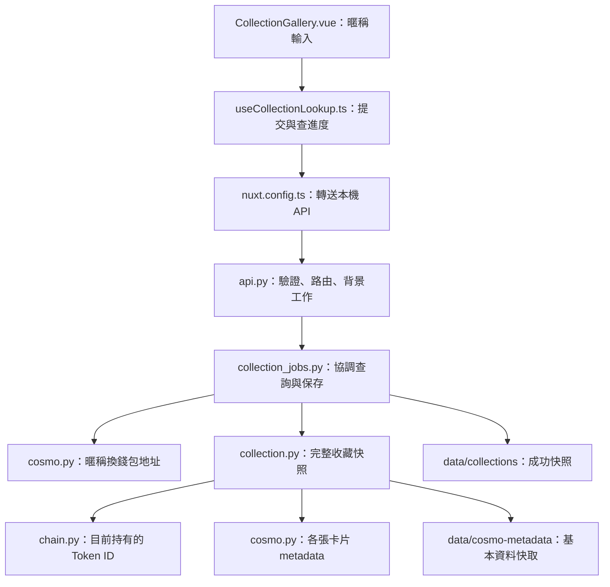

# 專案導讀：從暱稱到完整 Objekt 圖鑑

這份教學以現在可執行的程式為準。先跑一個小範例，再依資料流閱讀；第一次不用同時讀完所有函式。

## 1. 先跑最小範例

在專案根目錄執行，不需要先啟動網頁或 FastAPI：

```powershell
.\.venv\Scripts\python.exe -X utf8 -c "from cosmo import fetch_public_account; print(fetch_public_account('unproKPOPfan225'))"
```

成功時得到：

```python
{
    'nickname': 'unproKPOPfan225',
    'address': '0x75F3E9549397f98C536b8a70C51C4A201Da49C31'
}
```

這一行做三件事：`from ... import ...` 取得函式；`fetch_public_account(...)` 把暱稱交給官方介面；`print(...)` 顯示回傳的字典。輸入是暱稱，輸出是暱稱與錢包地址，這時還沒有卡片清單。`-X utf8` 避免 Windows 終端機的中文字元編碼問題。

先觀察這兩個欄位，再照 [README](../README.md#先執行) 啟動 API 與網頁，按一次「讀取收藏」。接著從第 3 節開始逐段讀。

## 2. 整體資料流程與檔案地圖



Python 將整份成功快照透過 API 回傳，Vue 驗證後更新圖鑑，再把當頁的每張卡交給 `OwnedObjektCard.vue`。資料已取得全部持有卡，分頁只決定現在顯示哪 60 張。

### Python 與測試檔案

| 檔案 | 功能與先看的位置 |
| --- | --- |
| [api.py](../api.py) | 本機 HTTP 入口。先讀 `NicknameRequest` 與 `create_app()` 裡的 `start()`；第 5 節解釋 |
| [collection_jobs.py](../collection_jobs.py) | 管理工作編號、進度、成功／失敗，保存完整快照。先讀 `CollectionJobs.run()`；第 6 節解釋 |
| [cosmo.py](../cosmo.py) | 直接查官方帳號與卡片基本資料，轉成我們的欄位。先讀 `fetch_public_account()`；第 7 節解釋 |
| [chain.py](../chain.py) | 透過 Abstract RPC，在同一區塊列出指定錢包的全部持有 Token ID。先讀 `fetch_owned_tokens()`；第 8 節解釋 |
| [collection.py](../collection.py) | 組合持有清單、metadata、快取與完整性驗證。先讀 `fetch_collection()`；第 9 節解釋 |
| [sync_collection.py](../sync_collection.py) | 可選的命令列入口，產生網頁的完整 JSON 備援。先讀 `main()`；第 10 節解釋 |
| [tests/test_api.py](../tests/test_api.py) | 驗證暱稱、工作進度、同時查詢限制、成功保存、失敗保留及並行原子寫入 |
| [tests/test_cosmo.py](../tests/test_cosmo.py) | 驗證官方欄位轉換、Unit 多成員、帳號與 Token ID 格式，避免猜測發行序號 |
| [tests/test_chain.py](../tests/test_chain.py) | 驗證批次回應還原、缺筆／重複／錯誤、同區塊枚舉、零持有與區塊變動 |
| [tests/test_collection.py](../tests/test_collection.py) | 驗證同款不同張、metadata 快取、拒絕部分快照及 CLI 失敗保留 |

### 網頁檔案

| 檔案 | 功能與關鍵位置 |
| --- | --- |
| [web/app/app.vue](../web/app/app.vue) | 整個網頁的根元件，只掛載 `<CollectionGallery />` |
| [CollectionGallery.vue](../web/app/components/CollectionGallery.vue) | 暱稱輸入、快照載入、統計、篩選與分頁；第 3 節解釋 |
| [useCollectionLookup.ts](../web/app/composables/useCollectionLookup.ts) | 提交暱稱、定期讀進度、處理 API 錯誤；第 4 節解釋 |
| [OwnedObjektCard.vue](../web/app/components/OwnedObjektCard.vue) | 顯示一張持有卡的圖片、成員、季節、代碼、Token ID；第 11 節解釋 |
| [types/objekt.ts](../web/app/types/objekt.ts) | `Objekt` 與 `CollectionSnapshot` 型別，描述卡片與完整快照的欄位 |
| [types/collection-job.ts](../web/app/types/collection-job.ts) | `CollectionJob` 型別，描述工作編號、四種狀態、進度、錯誤與結果 |
| [utils/collection.ts](../web/app/utils/collection.ts) | `parseCollectionSnapshot()` 真正檢查收到的資料，避免把錯誤回應當成收藏 |
| [assets/css/main.css](../web/app/assets/css/main.css) | 網頁配色、表單、卡片與響應式排版；第 11 節解釋 |
| [web/nuxt.config.ts](../web/nuxt.config.ts) | 客戶端渲染、API 轉送、樣式載入及網頁標題 |
| [web/tsconfig.json](../web/tsconfig.json) | 引用 Nuxt 產生的 TypeScript 設定，讓編輯器與型別檢查理解 Nuxt 專案 |
| [web/package.json](../web/package.json) | 網頁套件與 `dev`、`typecheck`、`build` 等執行命令 |
| [web/package-lock.json](../web/package-lock.json) | 鎖定實際依賴版本供 `npm ci` 重現安裝，由 npm 維護 |
| [web/README.md](../web/README.md) | 網頁操作與閱讀順序的短索引 |

### 專案設定與文件

| 檔案 | 功能與關鍵內容 |
| --- | --- |
| [requirements.txt](../requirements.txt) | 固定 FastAPI 與 Uvicorn 的直接依賴版本；前者處理 API，後者執行 HTTP 服務 |
| [requirements-dev.txt](../requirements-dev.txt) | `-r requirements.txt` 納入執行依賴，再加入 TestClient 使用的 httpx |
| [.gitignore](../.gitignore) | 排除本機資料、環境變數、Python／Node 依賴與產生檔；不會刪除檔案 |
| [README.md](../README.md) | 專案入口：啟動、驗證、目前功能與限制 |
| [docs/TEACHING.md](TEACHING.md) | 本文件：每個自訂檔案與關鍵程式碼的導讀 |
| [docs/cosmo-api.md](cosmo-api.md) | API 與合約的查找來源、Proxy 原理，以及已驗證和未驗證的範圍 |
| [AGENTS.md](../AGENTS.md) | Codex 協作規則、教學偏好與目前專案邊界 |
| [HANDOFF.md](../HANDOFF.md) | 接續工作所需的最新狀態、測試證據與待辦 |

### 執行後產生的本機資料

| 路徑 | 用途 |
| --- | --- |
| `data/collections/2741/<contract>/latest.json` | API 最近一次成功的完整收藏；重新整理網頁優先讀它 |
| 同目錄 `<wallet>.json` | 按錢包保存成功快照；目前未提供選擇歷史快照的介面 |
| `data/cosmo-metadata/2741/<contract>/<token>.json` | 每張卡的原始 metadata、Token ID 與快取時間 |
| `web/public/data/collection.json` | CLI 產生的可選備援，API 不可用或尚無成功資料時嘗試讀取 |
| `data/research/` | 最近一次圖鑑的本機驗證截圖，不參與執行 |
| `data/backups/` | 本次清理前的 ZIP 備份，不參與執行 |
| `.venv/`、`web/node_modules/` | 已安裝的 Python 與 Node 套件，保留供目前程式執行 |
| `__pycache__/`、`tests/__pycache__/` | Python 執行後產生的位元碼快取，可重建 |
| `web/.nuxt/`、`web/node_modules/.cache/` | Nuxt 的產生型別、開發／建置快取，可重建 |
| `web/.output/` | 正式建置輸出，可用 `npm run build` 重建 |

`data/` 與備援 JSON 已由 Git 忽略，新複製的專案可能沒有它們；查詢成功後會建立所需資料夾。

## 3. CollectionGallery.vue：輸入與畫面

```vue
<input id="cosmo-nickname" v-model="nickname" ...>
<form ... @submit.prevent="lookupCollection">
```

以上是語法摘錄，省略號表示其他屬性。`v-model` 把輸入框與 `nickname` 連在一起；`@submit` 監聽表單提交；`.prevent` 阻止瀏覽器照一般表單方式換頁。按鈕和輸入框都放在實際程式的 `<form>` 裡。

```ts
const nickname = ref(data.value?.account.nickname ?? '')
const target = nickname.value.trim().replace(/^@/, '')
const snapshot = await loadCollection(target)
if (!snapshot) return
data.value = snapshot
```

`ref()` 是 Vue 會追蹤變化的值，在 `<script>` 裡用 `.value` 讀寫，在模板通常會自動解開。`?.` 是前面有資料才往下取值；`?? ''` 是缺少資料時使用空字串。

`trim()` 去掉頭尾空白，`replace(/^@/, '')` 去掉開頭的一個 `@`。`await` 等待函式結果；失敗得到 `null` 就先離開，因此不會清空舊的 `data`。成功後才更新快照並清除先前的篩選。

初次開頁使用 `useAsyncData()`：先讀 `/api/collections/latest`，連線失敗或沒有資料時嘗試 `/data/collection.json`。讀到的內容仍須通過 `parseCollectionSnapshot()`；兩者都無法提供有效資料時，顯示輸入提示。

```ts
const pageCards = computed(() => filteredCards.value.slice(
  (currentPage.value - 1) * PAGE_SIZE,
  currentPage.value * PAGE_SIZE,
))
```

`computed()` 依其他值自動重新計算。`filteredCards` 用 `filter()` 篩選整份收藏；`slice(start, end)` 再取出本頁，包含起點、不含終點。第 1 頁就是索引 0 到 59。搜尋或篩選改變時，`watch()` 將頁碼重設為 1。

```vue
<OwnedObjektCard v-for="card in pageCards" :key="card.external_token_id" :objekt="card" />
```

`v-for` 為每張卡建立元件，`:objekt` 將卡片物件交給子元件。`:key` 使用個別 Token ID，同款兩張仍是不同紀錄。`members` 陣列包含 Unit 的個別成員，因此以 ChaeYeon 篩選，也能找到 `S4 X S18`。

熟悉後只改 `PAGE_SIZE = 60` 為 `24`，觀察頁數增加，但持有總數不變。這個值不控制鏈上查詢筆數。

## 4. useCollectionLookup.ts：提交與定期讀進度

```ts
let job = parseJob(await $fetch('/api/collections/sync', {
  method: 'POST', body: { nickname }, retry: 0, timeout: 10000, signal: controller.signal,
}))
```

`$fetch` 發出 HTTP 請求，`body: { nickname }` 傳送 JSON。POST 回應先給工作編號與狀態，收藏查詢在背景執行。`retry: 0` 避免提交動作自動重送；每次 HTTP 請求最多等待 10 秒。

```ts
while (!disposed) {
  // 先判斷 succeeded／failed，再等待並讀取下一次狀態。
  await new Promise(resolve => setTimeout(resolve, 1000))
  job = parseJob(await $fetch(`/api/collections/jobs/${job.job_id}`, ...))
}
```

這是流程摘錄。`Promise` 搭配 `setTimeout` 讓前端每秒問一次進度，等待時瀏覽器仍可操作。整體等待上限為 15 分鐘。

`parseJob()` 檢查工作編號、狀態等基本格式。成功後再用 `parseCollectionSnapshot()` 驗證收藏及暱稱，才回傳給畫面；`catch` 統一產生錯誤訊息，`finally` 恢復按鈕。`onScopeDispose()` 與 `AbortController` 在元件卸載時停止前端等待，不會取消已開始的 Python 工作。

## 5. api.py：FastAPI 入口

```python
class NicknameRequest(BaseModel):
    model_config = ConfigDict(extra="forbid")
    nickname: str = Field(min_length=1, max_length=64)
```

這是 Pydantic 資料模型，檢查請求必須有字串暱稱，長度 1–64，不接受額外欄位。`field_validator(..., mode="before")` 先去掉前後空白與開頭的 `@`，並拒絕控制字元；不合格回覆 HTTP 422。

```python
@app.post("/collections/sync", status_code=202)
def start(request: NicknameRequest, background_tasks: BackgroundTasks, response: Response):
    # 實際程式另有 Cache-Control 與忙碌時的錯誤處理。
    job, created = service.create(request.nickname)
    if created:
        background_tasks.add_task(service.run, job["job_id"])
    return job
```

`@app.post(...)` 將網址與函式連接。HTTP 202 表示已接受查詢；FastAPI 回應後，才執行加入的背景函式。它不會在回傳工作編號前等全部卡片查完。

| Python 路徑 | 用途 |
| --- | --- |
| `GET /health` | 確認 API 運行 |
| `POST /collections/sync` | 建立或沿用查詢工作 |
| `GET /collections/jobs/<job_id>` | 讀取進度、錯誤或成功快照 |
| `GET /collections/latest` | 讀取最近成功快照，還沒有時回覆 404 |

瀏覽器使用的路徑多了 `/api` 前綴，由 Nuxt 轉送。`create_app(jobs=...)` 允許測試傳入自己的工作管理器與暫存目錄，避免影響真實資料。

## 6. collection_jobs.py：把查詢串起來

`CollectionJobs` 是管理工作的類別，`self._jobs` 放各工作狀態，`self._active_id` 指向正在執行的工作。`Lock()` 確保不同 HTTP 請求不會同時修改這些共享資料。

`create()` 產生 `uuid4().hex` 工作編號。相同暱稱的進行中工作會沿用，其他暱稱回覆忙碌錯誤；最多保留 20 個工作的記憶體資料。API 重啟後舊工作編號失效。

```python
account = fetch_public_account(job["nickname"])
snapshot = fetch_collection(account, progress=lambda message: self._update(job_id, progress=message))
```

`run()` 的主線就是這兩步。`lambda` 是短函式，這裡把底層的進度文字交給 `_update()`，讓下一次 GET 能讀到。四種狀態是 `queued`（等待）、`running`（執行）、`succeeded`（成功）、`failed`（失敗）。

```python
write_json_atomic(self.directory / f"{account['address'].lower()}.json", snapshot)
write_json_atomic(self.directory / "latest.json", snapshot)
```

實際程式先驗證 `complete`、帳號、張數與不重複 Token ID，再保存錢包檔與最近成功檔，最後才標示成功。`Path / "檔名"` 是組合路徑，這裡的 `/` 不表示數學除法。

`except` 將不存在的暱稱、來源錯誤、儲存錯誤等轉成可顯示訊息；失敗不取代最近成功快照。`finally` 釋放目前工作的名額，讓下一次查詢能執行。現在是本機單一程序，沒有跨程序的工作佇列，因此 Uvicorn 不加 `--workers`。

## 7. cosmo.py：官方資料與欄位轉換

```python
data = _get_json(f"/bff/v3/users/by-nickname/{quote(username, safe='')}")
return {"nickname": nickname, "address": address}
```

`_get_json()` 用 `urllib.request` 送出 HTTPS GET，`json.load()` 將 JSON 轉成 Python 字典。f-string 把暱稱放進路徑；`quote()` 將路徑中的特殊字元編碼。回傳前檢查暱稱是否一致、錢包是否為合法的 40 位十六進位地址。

`fetch_objekt_metadata(token_id)` 用另一條路徑查指定卡片，`normalize_objekt_metadata()` 將 `attributes` 清單轉成我們使用的欄位。來源中的 `Member` 可能有多筆，所以會保留：

```python
"member": "S4 X S18",                  # 畫面上的組合名稱
"members": ["ChaeYeon", "JooBin"],    # 可搜尋、可篩選的個別成員
```

以上是某張 Unit 卡的欄位摘錄。一般卡片的 `members` 也會是一個陣列，因此前端可以使用同一套處理方式。函式建立新字典，不改動原始 metadata。它不會從名稱推算發行序號，也不會從圖片資料判定持有人。

## 8. chain.py：列出目前全部持有

`fetch_owned_tokens(address)` 先取得 Abstract 的 Chain ID 與最新區塊，再將本次所有持有查詢固定在這個區塊。這能避免查詢途中轉移卡片，導致混合不同時點的清單。

```python
owner_parameter = address[2:].lower().zfill(64)
balance_result = rpc_batch([
    _contract_call("0x70a08231" + owner_parameter, block_tag)
])[0]
total = decode_uint256(balance_result)
```

`address[2:]` 去掉 `0x`，`zfill(64)` 補零成合約參數需要的長度。`0x70a08231` 是 `balanceOf` 的函式識別碼；這個呼叫讀取持有張數。`decode_uint256()` 檢查完整的回傳格式，再以 `int(value, 16)` 將十六進位轉成整數。

接著用 `tokenOfOwnerByIndex(address, index)` 逐一列出持有 Token ID，識別碼為 `0x2f745c59`。`f"{index:064x}"` 將索引格式化為補零的 64 位十六進位字串。每批最多 50 個呼叫，只是減少 HTTP 往返；總共仍會查完 `total` 張。

`rpc_batch()` 是 JSON-RPC 的 HTTP POST，這裡呼叫 `eth_call` 等唯讀方法，不會送出鏈上交易。批次回應順序可能改變，因此用每筆的 `id` 還原；缺筆、重複、錯誤或不符的 id 都會拒絕。最後確認張數與 Token ID 唯一性。

`verify_snapshot_block()` 在卡片資料都取得後再檢查區塊雜湊，變動時拒絕這次快照。這份程式不需要私鑰或簽名。

## 9. collection.py：整合、快取與完整快照

```python
ownership = fetch_owned_tokens(account["address"], progress)
token_ids = ownership["token_ids"]
```

`fetch_collection()` 先取得持有清單。`_fetch_card()` 再為每個 Token ID 讀取 metadata：快取有效且未滿 24 小時就使用，否則向官方查詢。暫時性的失敗有限重試；持有清單本身不沿用這個 metadata 快取。

```python
with ThreadPoolExecutor(max_workers=METADATA_WORKERS) as executor:
    futures = {executor.submit(_fetch_card, token_id, cache_directory): token_id for token_id in token_ids}
    for future in as_completed(futures):
        token_id = futures[future]
        # 實際程式在這裡記錄成功、失敗與進度。
```

`ThreadPoolExecutor` 最多同時查 4 張卡的基本資料，適合等待網路回應的工作。`Future` 代表尚未完成的結果；`as_completed()` 先交出已完成的工作，因此完成順序不等於 Token ID 順序。這裡另用字典記錄每項工作的 Token ID。

全部成功後才依 Token ID 由大到小排列。任何一張 metadata 失敗，就拋出錯誤，不回傳部分快照。`set()` 將相同的「藝人、季節、成員／組合名稱、完整卡款代碼」合併計算不同卡款；每張持有紀錄仍分開保留。

`ownership_at` 是持有查詢區塊的時間，`fetched_at` 是這次整合完成時間。metadata 可能來自快取，因此同步完成時間不表示所有圖片資料都在那一秒重新下載。

### write_json_atomic() 為什麼不直接覆寫？

```python
with NamedTemporaryFile(..., dir=path.parent, delete=False) as stream:
    json.dump(data, stream, ensure_ascii=False, indent=2)
temporary.replace(path)
```

這是核心流程摘錄。先在同目錄完整寫好不同名稱的暫存檔，再原子替換目標，避免讀到半份 JSON。Windows 遇到短暫的目標鎖定時有限重試；`finally` 清掉暫存檔。這是單檔替換，不是資料庫交易。

## 10. sync_collection.py：保留的命令列工具

```python
USERNAME = "unproKPOPfan225"
account = fetch_public_account(USERNAME)
snapshot = fetch_collection(account, progress=lambda message: print(message, flush=True))
write_json_atomic(OUTPUT_PATH, snapshot)
```

以上是主流程摘錄。可以不啟動 FastAPI，直接執行 `python -X utf8 sync_collection.py` 觀察進度，或產生網頁完整 JSON 備援。日常從網頁查暱稱時，不必改這個常數。

它與 API 共用 `cosmo.py`、`chain.py`、`collection.py`，不重寫抓取邏輯。只有成功才寫入 `web/public/data/collection.json`，API 保存的 `data/collections/.../latest.json` 不受影響。

`if __name__ == "__main__":` 只在直接執行檔案時啟動，讓測試可以匯入而不真的連線。`SystemExit(main())` 將成功的 0、失敗的 1 交給終端機。

## 11. 卡片、型別、資料檢查與樣式

`app.vue` 只掛載圖鑑。`OwnedObjektCard.vue` 用 `defineProps<{ objekt: Objekt }>()` 接收父元件交進來的一張卡；`{{ objekt.member }}` 顯示文字，`:src="objekt.image_url"` 綁定圖片網址。`loading="lazy"` 延後載入較遠的圖片；`@error` 設定 `imageFailed`，由 `v-if` 改顯示替代文字，卡片其他資訊仍在。

`types/objekt.ts` 定義單張 `Objekt` 及整份 `CollectionSnapshot`。Token ID 用字串保存，`members` 固定為陣列；`complete: true` 表示此型別只代表完整快照。`types/collection-job.ts` 的狀態使用字串聯集，限制為四個名稱；`snapshot: unknown` 代表尚未驗證的結果。

TypeScript 型別只協助開發，不會自動驗證伺服器回應。`utils/collection.ts` 先將收到的值視為 `unknown`，逐項檢查欄位、帳號、鏈與合約、時間、完整性、卡款統計及 Token ID 唯一性，通過後才當成 `CollectionSnapshot` 使用。

`main.css` 的 `:root` 放全站顏色與字體，`.collection-grid` 用 CSS Grid 排卡片；`repeat(6, minmax(0, 1fr))` 代表六個可收縮的等寬欄位。`@media` 依寬度改成五／四／三／兩欄；手機也把暱稱輸入和按鈕改為直排。`prefers-reduced-motion` 尊重使用者的減少動態效果設定。

## 12. 設定檔與測試的關鍵

`nuxt.config.ts` 使用 `ssr: false`，由瀏覽器執行圖鑑。`css` 掛載樣式，`app.head` 設定中文、標題與描述。轉送設定是：

```ts
routeRules: {
  '/api/collections/**': { proxy: 'http://127.0.0.1:8000/collections/**' },
}
```

這讓前端向自己的網頁伺服器請求，再由它轉給 Python。例如 `/api/collections/latest` 對應 Python 的 `/collections/latest`。這個轉送用途和手機流量觀察不同。

`package.json` 的 `scripts` 決定 `npm run dev` 等命令做什麼；`dependencies` 是執行套件，`devDependencies` 是開發工具。`overrides` 保留先前對間接依賴 minimatch 的修正。`package-lock.json` 與 `npm ci` 搭配，安裝鎖定版本；`tsconfig.json` 交給 Nuxt 產生各執行範圍的 TypeScript 設定。

Python 的 `requirements*.txt` 用 `==` 固定直接依賴，`pip install -r requirements-dev.txt` 同時安裝執行與測試套件。完整測試使用 `unittest`，目前保留 28 項。`tests/test_api.py` 的 `TestClient(create_app(...))` 在程序內呼叫 API，不需先開 HTTP 服務；`patch()` 用人工回應取代網路函式，`TemporaryDirectory()` 避免寫進真實 `data/`。

目前 TestClient 的 Starlette 會提示 httpx 日後棄用，測試仍通過；後續可獨立處理測試依賴更新，不影響目前收藏資料查詢。

## 13. 本次清理與還原

清理前已把 27 個原始檔案封裝到 `data/backups/cleanup-before-20261119-181352.zip`，逐檔比對 SHA-256。ZIP 內的 `MANIFEST.json` 列出原路徑、雜湊與本次刪除的 19 個檔案。舊的 `read_collection.py` 包含使用者的 `PREVIEW_COUNT = 1` 修改，也保存在這裡。

| 已刪除的檔案 | 原因 |
| --- | --- |
| `main.py`、`importer.py` | 固定兩張卡的入門範例，現在的執行流程不引用 |
| `apollo.py`、`read_collection.py` | Apollo 第一頁教學，完整收藏已使用官方公開帳號與鏈上持有資料 |
| `prepare_web_data.py` | 單張卡片 JSON 產生器，已無使用它的展示頁 |
| `tests/test_importer.py`、`tests/test_apollo.py` | 對應被移除的舊範例，合計 13 項測試 |
| `web/app/components/ObjektCard.vue`、`web/app/utils/objekt.ts` | 舊單張元件與解析器，現有圖鑑未使用 |
| `web/public/data/objekt.json` | 舊單張展示資料 |
| `data/apollo-response.txt`、`data/apollo-decoded-page.json` | 已備份的早期來源樣本，不參與目前執行 |
| `data/research/apollo-index.js`、`apollo-profile-live.html` | 舊 Apollo 研究暫存 |
| `data/research/objekt-desktop.jpg`、`objekt-mobile.jpg` | 舊單張展示截圖 |
| `data/research/collection-desktop.jpg`、`collection-mobile.jpg` | 先前版本截圖，保留較新的暱稱查詢截圖 |
| `data/research/unit-metadata.json` | 單次研究樣本，現有轉換測試已覆蓋 Unit 行為 |

另外移除未使用的 `ObjektSnapshot` 型別、單張展示 CSS，並讓 `Objekt.members` 型別與現有資料驗證一致。根目錄／網頁 README、AGENTS、HANDOFF 也已整理為目前的入口，舊版文件可在同一 ZIP 中找到。

要查舊範例時，先用檔案總管將 ZIP 解壓縮到另一個資料夾，依 `MANIFEST.json` 查閱原路徑；只將需要的檔案複製回專案，避免用舊文件整包覆蓋目前版本。`.venv`、`node_modules`、目前成功快照、metadata 快取及完整 JSON 備援均保留。
